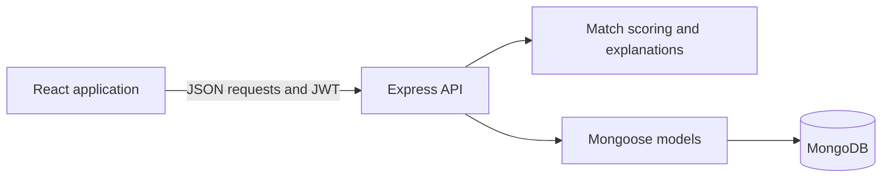

# PairUp

**Find an interview prep partner who shares your goals and schedule.**

PairUp helps NYU students connect for coding practice, system design, behavioral interviews, and product management prep. Students build a profile, discover compatible partners with clear match explanations, and coordinate practice through invitations, chat, and session proposals.

Built by a five-person team for NYU's Agile & DevOps course using **React, Express, and MongoDB**.

[UX design and wireframes](UX-DESIGN.md) · [Development guide](docs/DEVELOPMENT.md) · [Contributing](CONTRIBUTING.md)

## Features

- **Profile and onboarding:** capture target role, practice areas, experience, interview timeline, feedback style, and weekly availability.
- **Partner discovery:** browse ranked recommendations or a shuffled sample, inspect profiles, and see reasons for a match.
- **Connection requests:** send, accept, decline, and cancel invitations; manage accepted partnerships.
- **Partner space:** exchange messages and propose practice sessions with a partner.
- **Account settings:** edit profile information, email, password, and notification preferences.
- **Authentication:** bcrypt password hashing and JWT authentication for protected API routes.

## How matching works

The matching API excludes the current user, profiles missing a role or full availability grid, existing pending or accepted connections, and candidates with no shared availability. It scores the remaining candidates using seven factors:

| Factor | Maximum points |
| --- | ---: |
| Shared availability | 35 |
| Practice focus | 20 |
| Experience level | 20 |
| Interview timeline | 10 |
| Target company tier | 8 |
| Feedback style | 4 |
| Preferred interview order | 3 |

These weights sum to 100 for same-role matches. Cross-role matches use reduced credit for level and practice overlap. The ranked endpoint sorts by match percentage, shared availability, then profile creation time. Explanations translate the scoring factors into reasons students can read before connecting.

The score is a rule-based compatibility heuristic, not a measured probability of a successful partnership. See [match scoring](back-end/modules/matchScoring.js), [match explanations](back-end/modules/matchReasons.js), and the [matching routes](back-end/routes/matches.js).

## Architecture



The frontend and API run as separate services. During development, React proxies `/api` requests to Express. The Docker frontend uses Nginx for static hosting and API proxying.

## Run locally

Use Node.js **20.19 or newer** and npm, plus a local MongoDB instance or a MongoDB Atlas database. Install dependencies in each service; the repository root has no application package.

Start the API:

```bash
git clone https://github.com/agile-students-spring2026/final-team-pairup.git
cd final-team-pairup/back-end
npm install
cp .env.example .env
```

Edit `back-end/.env`: set `MONGODB_URI` to your development database and replace `JWT_SECRET` with a long random secret. Then, from `back-end/`:

```bash
npm start
```

In a second terminal, from the repository root:

```bash
cd front-end
npm install
PORT=3001 npm start
```

Open [localhost:3001](http://localhost:3001). The API runs on [localhost:3000](http://localhost:3000), matching the frontend's development proxy. Register an account and complete onboarding. A fresh database has no other profiles; use a second account with overlapping availability or the optional development seed described in the [development guide](docs/DEVELOPMENT.md#sample-data).

See the [development guide](docs/DEVELOPMENT.md) for environment variables, Docker setup, tests, deployment configuration, and troubleshooting.

## Validation

```bash
# Backend integration suite; requires a separate disposable TEST_MONGODB_URI
cd back-end
npm test
```

```bash
# Frontend tests and production build
cd front-end
CI=true npm test -- --watchAll=false
npm run build
```

Backend tests cover matching, users, invitations, meetings, session proposals, and chat. Frontend tests cover routing, partner screens, scheduling helpers, and relative times. [GitHub Actions](.github/workflows/ci.yml) runs the backend suite and frontend production build on pushes and pull requests; frontend tests can be run locally with the command above.

**Backend tests clear collections in the configured test database.** Use a dedicated disposable database; see [test configuration](docs/DEVELOPMENT.md#tests).

## Repository layout

```text
front-end/             React UI, routes, components, and frontend tests
back-end/              Express API, Mongoose models, matching logic, and tests
docs/                  Development and deployment notes
docker-compose.yml     API and Nginx frontend services
UX-DESIGN.md            Design walkthrough and prototype link
ux-design/             App map, early wireframes, and design source
instructions/          Original course milestones and assignment instructions
.github/               CI, issue templates, and course automation
```

## Scope and limitations

This is a course project with API-backed core flows. The [wireframes](UX-DESIGN.md) document early design intent; some planned flows differ from the implementation. Password recovery currently returns a placeholder response without sending a reset email. Group matching and feedback-driven recommendations remain future work. The matching endpoint loads candidate profiles into memory, so larger deployments would need pagination and database-side filtering.

Dockerfiles, Compose configuration, and GitHub Actions are included. Railway deployment notes are in the [development guide](docs/DEVELOPMENT.md#deployment).

## Team

| Contributor | GitHub |
| --- | --- |
| Saun Chen | [Saun321](https://github.com/Saun321) |
| Scott Kim | [jk8308-jpg](https://github.com/jk8308-jpg) |
| Eddie Liu | [eddieliu-dev](https://github.com/eddieliu-dev) |
| Louisia Liu | [LouisaQvQ](https://github.com/LouisaQvQ) |
| Ruilin Ma | [RuilinMa0526](https://github.com/RuilinMa0526) |

## License

See [LICENSE.md](LICENSE.md) for the included GNU General Public License v3 text.
